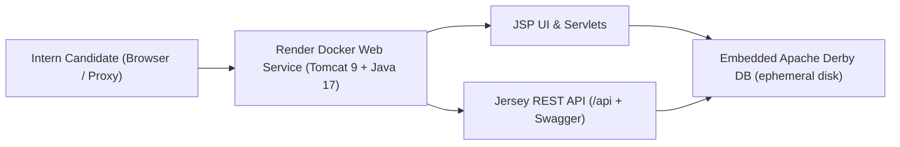

# Cybersecurity Internship Assessment — POC Proposal

> **Audience:** Senior Developer / Hiring Team Review  
> **Base Application:** AltoroJ (Java / JSP / Servlet banking web app with REST API & embedded Apache Derby DB)  
> **Status:** Working local build verified (Gradle + Apache Tomcat 9 / Java 17); Render Docker deployment config ready.

---

## 1. Executive Summary

This Proof of Concept (POC) adapts **AltoroJ**—a self-contained Java banking web application with a Swagger-documented REST API—into a practical security assessment for cybersecurity internship applicants.

**What this assessment evaluates:**
- Ability to identify classic web and API vulnerabilities across OWASP Top 10 categories (Injection, Broken Access Control, XSS, Weak Auth/Sessions, CSRF, Business Logic).
- Practical understanding of **root cause** and **business impact**, not just running automated scanners.
- Quality of **remediation thinking** (secure coding / architectural fixes) and clear technical reporting.

---

## 2. Architecture & Hosting Plan

AltoroJ is a monolithic J2EE `.war` application—**Tomcat renders both the JSP frontend and the backend Servlets/REST API**, backed by an embedded Apache Derby database initialized on first login. Because there is no decoupled SPA frontend, **a single Docker Web Service on Render** hosts the entire application (no Vercel deployment required).



### Delivery Options to Choose From
| Delivery Mode | Pros | Trade-offs / Guardrails |
| :--- | :--- | :--- |
| **Option A: Render Docker URL** *(included via `Dockerfile` + `render.yaml`)* | Zero setup friction for candidates; single link to share; free-tier restarts auto-reset the Derby DB. | Shared instance across candidates; enforce manual-testing-only rules; suspend/delete service after the cohort finishes. |
| **Option B: Per-Candidate Local Docker** | Complete isolation per candidate; safe to enable admin/persistent-XSS flags; tests basic container skills. | Requires candidates to have Docker installed locally. |

### Production Safety Guardrails (`AltoroJ/WebContent/WEB-INF/app.properties`)
- Keep `advancedStaticPageProcessing` **disabled** (prevents host shell execution).
- Keep `enableAdminFunctions` **disabled** on a shared Render URL so one candidate cannot break logins for others (or enable only in isolated per-candidate containers).
- Optional: enable `database.reinitializeOnStart=true` so every restart resets data to a clean baseline.
- Never attach real credentials, internal network routes, or production cloud metadata to the deployment.

---

## 3. Ready-to-Send Candidate Brief

> *Copy/adapt this section when sending the task to interns.*

### Task Title: Web Application Security Assessment
- **Target URL:** `https://<your-deployed-url>/` *(or `http://localhost:8080/` if running locally via Docker)*
- **Test Credentials:** Username `jsmith` / Password `demo1234`
- **Mode:** Black-box *(or Grey-box if we choose to share the source repo)*
- **Recommended Timebox:** 2–4 hours (or 48-hour take-home window)

### Rules of Engagement
1. Perform **manual security analysis only** (browser DevTools, HTTP proxy inspection, manual API requests). Do **not** run heavy automated scanners, brute-force tools, or denial-of-service traffic against the hosted environment.
2. Only test the assigned target URL and its `/api` endpoints.
3. Do not attempt to access the underlying host OS or disrupt access for other candidates.

### Expected Deliverable
Submit a concise **Security Assessment Report** (PDF or Markdown) addressing the questions below. For each issue you identify, document:
1. **Affected Feature / Endpoint**
2. **Vulnerability Class & Root Cause**
3. **Security & Business Impact**
4. **High-Level Evidence / Observation**
5. **Recommended Remediation** (concrete architectural or code-level defense)

---

## 4. Assessment Questions & High-Level Reviewer Guide

Each question below maps to verified weaknesses in this repository. Reviewer notes summarize the **underlying security concept and defensive fix** for evaluating candidate explanations.

### Q1. Authentication & Data Query Safety (Injection)
- **Candidate Prompt:** Evaluate how the login flow and transaction date filters interact with the backend database. What security weakness exists, what is the worst-case impact, and how should database queries be implemented securely?
- **Relevant Code:** `AltoroJ/src/com/ibm/security/appscan/altoromutual/util/DBUtil.java`
- **Reviewer Concept Note:** Queries are constructed via direct string concatenation instead of separating SQL structure from user-supplied parameters. Look for candidates to explain why untrusted input can alter query logic and to recommend parameterized queries (`PreparedStatement`) alongside strict input validation.

### Q2. Output Handling & Filtering (Cross-Site Scripting)
- **Candidate Prompt:** Inspect user-controlled output across features such as site search, language customization, and feedback submission. Identify where untrusted input is mishandled and explain why regex-based denylists are an unreliable defense.
- **Relevant Code:** `AltoroJ/WebContent/search.jsp`, `AltoroJ/WebContent/bank/customize.jsp`, `AltoroJ/WebContent/feedbacksuccess.jsp`, `AltoroJ/src/com/ibm/security/appscan/altoromutual/util/ServletUtil.java`
- **Reviewer Concept Note:** User input is echoed directly into HTML responses or filtered using an incomplete regex denylist (`sanitzieHtmlWithRegex`). Look for candidates to distinguish reflected vs. stored XSS risks and recommend context-aware output encoding plus a restrictive Content Security Policy (CSP).

### Q3. Role Enforcement & Administrative Access (Broken Access Control)
- **Candidate Prompt:** Assess whether administrative functionality is properly isolated from regular banking users across both the web interface and the REST API. Explain how authorization should be architected to prevent privilege escalation.
- **Relevant Code:** `AltoroJ/WebContent/WEB-INF/web.xml`, `AltoroJ/src/com/ibm/security/appscan/altoromutual/filter/AdminFilter.java`, `AltoroJ/src/com/ibm/security/appscan/altoromutual/api/AdminAPI.java`
- **Reviewer Concept Note:** A filter URL-pattern misconfiguration in `web.xml` (`/adimn/*` instead of `/admin/*`) prevents `AdminFilter` from protecting `/admin/*`, and `AdminAPI` omits role checks altogether. Look for candidates to emphasize fail-closed server-side RBAC on every privileged route and regression tests for authorization rules.

### Q4. Object Ownership & Client-Side State Trust (IDOR / Business Logic)
- **Candidate Prompt:** Review account balance viewing, transaction history APIs, and the fund transfer workflow. Identify places where the server trusts client-supplied identifiers or cookies without verifying ownership or account state.
- **Relevant Code:** `AltoroJ/WebContent/bank/balance.jsp`, `AltoroJ/src/com/ibm/security/appscan/altoromutual/api/AccountAPI.java`, `AltoroJ/src/com/ibm/security/appscan/altoromutual/util/OperationsUtil.java`
- **Reviewer Concept Note:** Account endpoints return data for arbitrary account IDs without checking ownership against the authenticated user, transfers trust a client-supplied Base64 cookie (`AltoroAccounts`), and balances are not validated atomically. Candidates should advocate authoritative server-side ownership checks and transactional balance validation.

### Q5. API Token Design, Session Lifecycle & Request Integrity
- **Candidate Prompt:** Examine how the REST API authenticates requests, how browser sessions are terminated on logout, and how state-changing fund transfers are submitted. Identify flaws in session/token management and request integrity.
- **Relevant Code:** `AltoroJ/src/com/ibm/security/appscan/altoromutual/api/LoginAPI.java`, `AltoroJ/src/com/ibm/security/appscan/altoromutual/filter/ApiAuthFilter.java`, `AltoroJ/src/com/ibm/security/appscan/altoromutual/servlet/LoginServlet.java`, `AltoroJ/src/com/ibm/security/appscan/altoromutual/servlet/TransferServlet.java`
- **Reviewer Concept Note:** API tokens simply Base64-encode raw credentials without signing or expiry, logout clears only a single attribute instead of invalidating the session, cookies omit hardening flags (`HttpOnly`/`Secure`/`SameSite`), and fund transfers accept `GET` requests without anti-CSRF tokens. Candidates should recommend signed/expiring tokens, full session invalidation, hardened cookies, and POST-only actions with CSRF protection.

### Q6. *(Optional Bonus — Grey-Box / Deeper Audit)* Redirects & Credential Hygiene
- **Candidate Prompt:** Identify any additional security hygiene issues in redirects, hardcoded credentials, password storage/logging, or client-side-only validation.
- **Relevant Code:** `AltoroJ/WebContent/bank/customize.jsp` (unvalidated redirect), `AltoroJ/src/com/ibm/security/appscan/altoromutual/servlet/AdminLoginServlet.java` (hardcoded password), `AltoroJ/src/com/ibm/security/appscan/altoromutual/servlet/LoginServlet.java` (case-insensitive & logged passwords), `AltoroJ/WebContent/bank/transaction.jsp` (JS-only date validation).

---

## 5. Proposed Customizations ("Our Own Touch") — For Senior Dev Sign-Off

Before rolling this out to interns, we can apply lightweight customizations so the project isn't immediately recognizable by name and reflects our domain:

1. **Custom Rebranding:** Rename "Altoro Mutual" across `header.jspf`, `footer.jspf`, `index.jsp`, and `web.xml` to a fictional internal brand (e.g., *NovaTrust Bank* / *Acme FinTech*) and replace the logo/theme CSS.
2. **Custom Scenario / Business Logic Challenge:** Add 1–2 company-relevant endpoints (e.g., an invoice download or profile update endpoint) tailored to our tech stack.
3. **Optional Stored XSS Toggle:** Enable `enableFeedbackRetention=true` in `app.properties` if running isolated per-candidate instances so interns can also assess stored XSS in `/admin/feedbackReview.jsp`.
4. **Black-Box vs. Grey-Box Decision:** Decide whether interns receive only the URL (pure discovery) or both the URL and a zipped repo (discovery + secure code patch).

---

## 6. How to Run & Deploy This POC

### Local Run (Already Verified on This Machine)
```bash
# Build WAR
gradle -p AltoroJ war

# Deploy to Homebrew Tomcat 9 and start on http://localhost:8080/altoromutual/
cp AltoroJ/build/libs/altoromutual.war /opt/homebrew/opt/tomcat@9/libexec/webapps/altoromutual.war
JAVA_HOME=/opt/homebrew/opt/openjdk@17/libexec/openjdk.jdk/Contents/Home /opt/homebrew/opt/tomcat@9/bin/catalina run
```

### Deploy on Render (Single Web Service)
1. Push this repository (including `Dockerfile`, `render.yaml`, and `AltoroJ/`) to GitHub.
2. In Render, choose **New + -> Blueprint** (uses `render.yaml`) or **New + -> Web Service -> Docker**.
3. Render builds the WAR via Gradle and deploys it at the root URL (`https://<service>.onrender.com/`).
4. Verify homepage (`200 OK`) and test login (`jsmith` / `demo1234`), then share the Candidate Brief.
